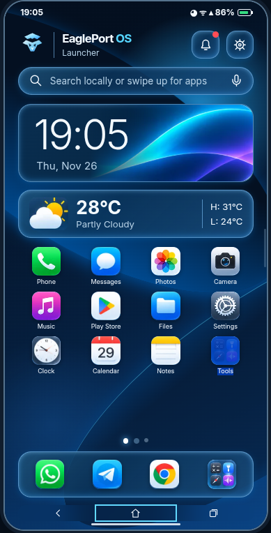
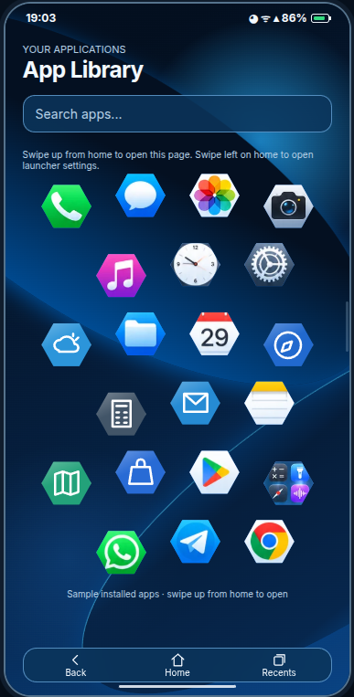
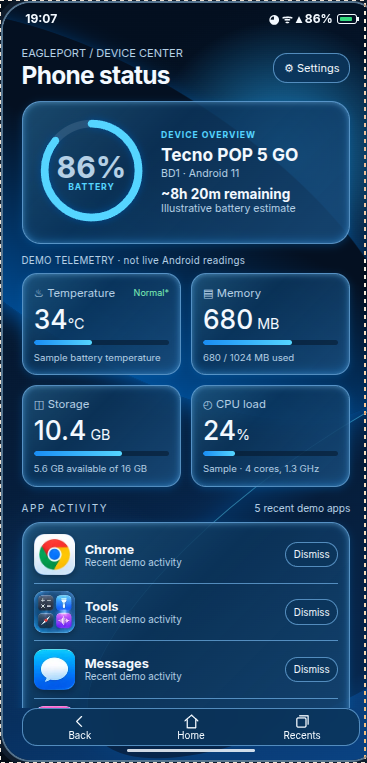

<div align="center">

# 🦅 EaglePort OS Launcher

**Ultra-lightweight Glass UI Android Launcher crafted for entry-level & 1 GB RAM phones**

-3DDC84?style=for-the-badge&logo=android&logoColor=white)


[**⬇️ Download Latest APK**](https://github.com/Jeran24/Releases/raw/main/Android-releases/EaglePortOs.apk)

</div>

---

## 📸 Visual Tour

<table>
  <tr>
    <td align="center" width="25%">
      <br/>
      <b>🏠 Glass Home</b><br/>
      <sub>Clock, Weather & Smart Dock</sub>
    </td>
    <td align="center" width="25%">
      <br/>
      <b>⬡ App Library</b><br/>
      <sub>Hex Grid & Instant Search</sub>
    </td>
    <td align="center" width="25%">
      <br/>
      <b>📊 Device Center</b><br/>
      <sub>Battery, RAM, Storage & CPU</sub>
    </td>
   
  </tr>
</table>

---

## ✨ At a Glance

| Feature | Visual Preview | Gesture / Action |
| :--- | :--- | :--- |
| **🏠 Glass Home** | Clock card, `28°C` Weather widget, 4×3 grid + 4-app dock | **Tap** icons or widgets |
| **⬡ App Library** | Hexagonal app icons + live search bar | **Swipe Up** from Home |
| **📊 Device Center** | Battery ring, Temp, RAM (`1024 MB`), Storage & CPU cards | **Tap** top status / settings |
| **⚙️ Launcher Settings** | Custom glass theme & layout controls | **Swipe Left** from Home |

---

## 📲 Quick Install

```
 1. Download EaglePortOs.apk  ──▶  2. Tap APK & Allow Unknown Apps  ──▶  3. Set as Default Home App
```